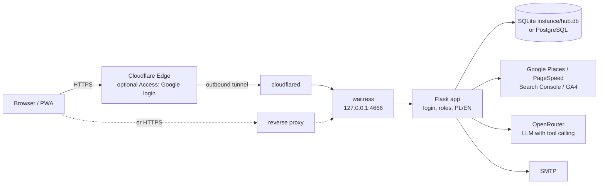
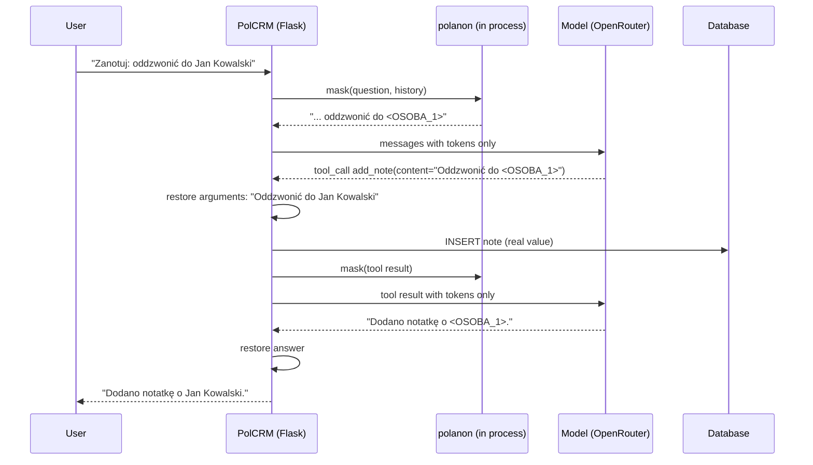

# Architecture

PolCRM is a single Flask application rendered on the server with Jinja2, on SQLite (one file, fine
for a small team) or PostgreSQL. It favors one process and no front-end build step at run time over
horizontal scaling; the only build artifact, the Tailwind CSS, is committed.

## Runtime

- The app listens on `127.0.0.1` only. It reaches the internet through `cloudflared` (an outbound
  tunnel, so no port is open) or a reverse proxy with HTTPS. Cloudflare Access in front of it is
  optional with password login and required with `AUTH_MODE=cloudflare`.
- Every page requires a login (`core.require_login`). `AUTH_MODE` picks how: `password` (default,
  e-mail and password), `cloudflare` (identity from the Cloudflare Access header, checked against
  `ALLOWED_EMAILS`) or `profile` (a passwordless picker for local demos, refused in production).
  See "Authentication and roles" below.
- On start the app backs up a SQLite database (last 10 copies), creates missing tables, adds
  columns that older SQLite databases lack (`models.ensure_schema`, idempotent `ALTER TABLE`),
  creates query indexes and seeds default packages and templates (Polish or English, by
  `DEFAULT_LANGUAGE`). PostgreSQL starts from the full schema created by `create_all()`.

## Modules

| File | Responsibility |
|---|---|
| `app.py` | entry point: imports `core` (the app) and `routes` (registers every route), runs waitress or the dev server |
| `core.py` | configuration from the environment, login and roles (`get_current_user`, `admin_required`), request hooks (language, login, Google API key check), template globals, shared helpers |
| `routes/*.py` | routes grouped by area (companies, leads, audits, tasks, finances, contracts, team, assistant...). They are attached to the one Flask app, not blueprints, so endpoint names and URLs stayed the same when `app.py` was split |
| `auth.py` | auth modes, password policy, login rate limiter, session fingerprint (no Flask or DB imports, unit-tested on its own) |
| `i18n.py` | interface language: catalog from `translations/en/*.json`, Jinja i18n, dates in both languages |
| `models.py` | SQLAlchemy models, roles and labels, schema patches for older SQLite databases, indexes, default data |
| `ai_assistant.py` | tool definitions, tool executors, the tool-calling loop, OpenRouter client |
| `privacy.py` | optional PII masking with polanon (no Flask or DB imports, unit-testable) |
| `scoring.py` | 5-area audit score from Google Places data and PageSpeed Insights |
| `google_sync.py` | OAuth 2.0 flow, Search Console and GA4 snapshots (on demand) |
| `finance_helpers.py` | monthly balance, MRR, overdue flags, retainer payment generation |
| `email_sender.py` | SMTP and e-mail templates rendered in a Jinja2 sandbox |
| `crypto_utils.py` | Fernet and the `EncryptedText` column type (secrets encrypted at rest) |
| `contract_pdf.py`, `pdf_report.py` | PDF contracts and audit reports (fpdf2, DejaVu font) |
| `static/css/tailwind.css` | Tailwind utilities built from the templates (`tailwind.config.js`); linked last in `<head>`, where the Play CDN used to inject its styles, so the cascade with `style.css` is unchanged |

## Authentication and roles

- **password** (default): `/login` checks the e-mail and a scrypt hash (Werkzeug). A failed login
  counts against the (IP, e-mail) pair and the IP (`auth.LoginRateLimiter`, sliding window, thread
  safe for waitress); the error message is the same for an unknown e-mail and a wrong password.
  Login clears the old session (fixation) and stores the user id and a fingerprint of the password
  hash in the signed session cookie: changing a password logs out every other session, and a
  deactivated account is rejected on its next request.
- **First run:** while no active administrator exists, every page leads to `/setup`, which creates
  one and then answers 404. `scripts/create_admin.py` does the same from a shell (hidden password
  prompt) and restores access.
- **cloudflare:** the identity is the `Cf-Access-Authenticated-User-Email` header only (never a
  cookie), checked against `ALLOWED_EMAILS`; unknown allowed e-mails get member accounts, the first
  account in an empty database becomes administrator. Safe only when the app is reachable through
  the tunnel alone.
- **Roles:** `admin` manages the team, company settings, API keys and integrations; `member` works
  on the data. `admin_required` guards those routes on the server, the settings page hides the
  admin tabs, and the last active administrator cannot be demoted or deactivated.
- The current user is resolved once per request and cached in `flask.g` (templates, hooks and the
  SQLAlchemy attribution event all ask for it).

## Languages

Polish strings in the code are the message keys; `translations/en/*.json` hold the English (one file
per area, merged on start, conflicting duplicates refused). Templates use `{{ _('...') }}` through
Jinja's i18n extension (new-style gettext: values are escaped), Python uses `i18n._()`, JavaScript
gets its strings as `window.POLCRM_I18N` and calls `t()`. The language is the user's profile setting;
before login the `polcrm_lang` cookie, the browser's Accept-Language, then `DEFAULT_LANGUAGE`.
Data stays in the language it was written in. Two tests keep it honest: every marked string has a
translation with the same placeholders, and `scripts/i18n_check.py` renders every page for an
English-speaking user and fails on Polish interface text (database values are subtracted first).

## Databases

`DATABASE_URL` selects SQLite (default `instance/hub.db`) or PostgreSQL (`postgresql+psycopg://`).
The code uses only portable SQLAlchemy constructs; the test suite runs unchanged on both
(`TEST_DATABASE_URL`, a separate CI job on PostgreSQL 16). `docker-compose.yml` runs the app with
PostgreSQL. Schema changes for existing PostgreSQL databases will need migrations (Alembic) in a
later version; older SQLite databases are patched on start.

## AI assistant: the tool-calling loop

The assistant is a plain loop over the OpenAI-compatible chat API exposed by OpenRouter:

1. Build the messages: system prompt with today's date, the last turns of the conversation (kept
   in the session cookie, trimmed to stay under the cookie size limit) and the new question.
2. Call the model with 12 tool definitions (JSON Schema).
3. If the answer contains `tool_calls`, run each tool against the database, append the result as a
   `tool` message and call the model again.
4. Stop when the model answers with text, or after 6 rounds.

There are no destructive tools: deleting data is left to the UI on purpose.

The endpoint is OpenRouter by default; `OPENROUTER_URL` points the same loop at any
OpenAI-compatible gateway (LiteLLM, a self-hosted model), in which case the data never leaves
your infrastructure. Tool executors return plain dicts and report failures as `{"error": ...}`,
so the model can correct its arguments in the next round instead of the request failing.

## PII masking with polanon

When **Settings → AI Assistant → Mask personal data** is on, `ai_assistant.build_masker()` returns
a `privacy.Masker` for the request. It holds one mapping (token → real value) in memory for the
whole request, so the same value gets the same token in the question, the history and every tool
result.

Design rules:

- **Fail closed.** If masking is on and polanon is missing or raises, `MaskingUnavailable` stops the
  request before the first call to the model (or before the next one, if it fails on a tool
  result). The user gets an error; nothing is sent in clear text.
- **Known client names are always masked.** Tool results are masked field by field, so a
  company name arrives without a sentence around it, and polanon's rules alone let a name like
  "Auto Serwis Nowak" through. `build_masker()` therefore passes every client's trade and legal
  name from the CRM to polanon's `DenylistGuard` (`privacy.client_terms`), reusing the cached
  guards so the spaCy model is not reloaded. The words of those names are also removed from
  polanon's allowlist of well-known names for that request, so a client called like a big brand
  is not let through as "public".
- **Optional dependency.** polanon is imported lazily. Without it, and with masking off, the
  assistant behaves exactly as before.
- **One anonymizer per process.** Building polanon's guards (and loading the spaCy model when NER is
  on) is the expensive part; the `Anonymizer` keeps no per-call state, so it is cached and shared.
- **Real values stay local.** The mapping lives only for the request. The local trace of tool calls
  (`tools_called`) keeps real values; it is never sent to the model.
- **Tokens the model invents** (not in the mapping) are left as they are and logged as a count,
  never with a value.

Tests: `tests/test_privacy.py` (contract with a fake anonymizer), `tests/test_polanon_real.py`
(the same with the real library), `tests/test_app_smoke.py::test_assistant_api_masks_end_to_end`
(HTTP request → masked model calls → note saved with the real value).

## Data and secrets

- Data: `instance/hub.db` (SQLite) and `output/` (generated CSV/PDF files, uploads, whiteboard
  images). Both are ignored by git.
- Secrets in the database (Google Maps API key, OpenRouter key, SMTP password, OAuth client secret
  and refresh tokens) are encrypted with Fernet. The key comes from `FERNET_KEY`; in development,
  when it is missing, a key is generated once into `instance/fernet_dev.key`. Older installations
  that kept the key in the `settings` table are still read.
- Client credentials are stored as links to a password manager, never as passwords.

## Tests and CI

`python -m pytest` runs every test on a throw-away database filled by `scripts/seed_test_data.py`
(SQLite by default, PostgreSQL with `TEST_DATABASE_URL`). Generated PDFs and uploads land in
`output/` and the development Fernet key in `instance/`, as when the app runs (both git-ignored). GitHub Actions runs `ruff check .`
(pyflakes rules) and the suite on Ubuntu (Python 3.12 and 3.13) and Windows (Python 3.13) with polanon
installed, the same suite on PostgreSQL 16, builds the Docker image and validates
`docker-compose.yml`, and rebuilds Tailwind to check the committed CSS is up to date.

| File | What it covers |
|---|---|
| `tests/test_privacy.py` | masking contract with a fake anonymizer: what the model, the tools and the user see; fail closed |
| `tests/test_polanon_real.py` | the same with the real polanon, plus known client names and allowlisted brands |
| `tests/test_auth.py` | auth modes, password policy, rate limiting, login, roles, team management, first-run setup |
| `tests/test_i18n.py` | translation catalog completeness and placeholders, language switch, dates, no Polish in the English UI, manifest and first-run language, activity labels |
| `tests/test_app_smoke.py` | every main screen on seed data, a crawl of every GET route (no 5xx, network blocked), the assistant endpoint end to end, encryption at rest, Cloudflare Access mode |
| `tests/test_contracts_whiteboard.py` | contract template to PDF to download, unique PDF files, versioned file uploads with safe storage, whiteboard drawing API |
| `tests/test_audits.py` | the demo audit: Google key gate, edit form, HTML and PDF report in Polish and English, saving checklists and the plan |
| `tests/test_delete_cascade.py` | deleting a company with one of every linked record, and a whiteboard with erased elements (foreign keys on PostgreSQL) |
| `tests/test_regressions.py` | bugs fixed before publication: XSS, settings tabs, 0% VAT, nested form, logout, PDFs, indexes, custom endpoint, SRI, local Tailwind |
| `tests/test_finance_scoring.py` | retainers, overdue payments, monthly balance, audit scoring |
| `tests/test_forms.py` | main forms end to end: company create/delete, task create/done, payment gross and number, note sanitising |
